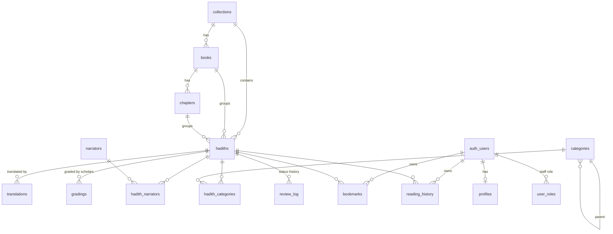

# Xadiith App — Backend Architecture & Database Design (v2)

Status: **designed, migrations written, NOT applied** (2026-11-20).
Platform: the existing **Supabase** project (Postgres + Auth + PostgREST). No
other platform is introduced. The Flutter frontend is unchanged by this step.

Facts checked on 2026-11-20 (publishable key, read-only): project reachable,
e-mail auth on with confirmation required, **no catalogue tables exist** (all
REST paths 404). Nothing in the database had to be preserved or migrated.

---

## 1. Architecture

```
Flutter app ──(HTTPS, publishable key + user JWT)──▶ Supabase
  ├─ Supabase Auth  : sign-up / sign-in / reset (already wired in the app)
  ├─ PostgREST      : SELECT on tables & views, protected by RLS
  ├─ RPC functions  : search_hadiths, daily_hadith (security invoker → RLS)
  └─ review_record  : status changes, reviewers only (security definer, checked)

Trusted machine ──(secret key, never in the app)──▶ import script
  └─ inserts records as 'imported' (cannot verify or publish)
```

* **Reads**: small metadata (collections, books, chapters, categories) is
  fetched once and cached; hadith rows are fetched **per chapter, paginated**,
  and cached; search goes to the server.
* **Writes from the app**: only the user's own bookmarks, reading history and
  profile. The app never writes catalogue data.
* **Admin / content management**: Supabase dashboard + the import script +
  `review_record()`. A dedicated admin web panel is optional, later.
* **Errors**: PostgREST returns `{code, message, details, hint}`; the app maps
  `PGRST116` (not found), `42501` (not allowed), timeouts and network errors to
  Somali messages and keeps showing cached data.
* **Logging**: `review_log` (every status change, with actor and note);
  Supabase API/Postgres logs for operations. No analytics.

## 2. Entity relationships



## 3. Tables (summary — full DDL in `supabase/migrations/`)

| Table | Key columns | Integrity |
|---|---|---|
| `collections` | `id` slug, `name_ar`, `name_en`, `name_so` + `name_so_verified`, compiler, edition, publisher, `source_reference`, `source_url`, `metadata` | slug check, URL check |
| `books` (kitab) | `collection_id`, `book_number` (text, as source), titles ar/en/so, `sort_order` | unique (collection, book_number) |
| `chapters` (bab) | `book_id`, `chapter_number` (nullable), titles, `sort_order` | unique (book, sort_order) |
| `categories` | `id` slug, `parent_id`, `name_ar`, `name_so`, `sort_order` | no self-parent |
| `narrators` | `name_ar`, `alt_names_ar[]`, kunya, `death_year_ah`, `biography_refs` (json list of source/reference/url), `status` | separate review status |
| `hadiths` | `collection_id`, `book_id`, `chapter_id`, `numbering_scheme` + `hadith_number` (text), `source_position`, **`arabic_text` (exact source)**, `arabic_text_vowelized` + `vowelized_verified`, `narrator_text_ar`, `source_name/edition/identifier/url`, `normalization_notes`, `status`, `verified_by/at`, `published_at` | unique (collection, scheme, number); unique (collection, position); composite FKs guarantee chapter ∈ book ∈ collection; verified/published require reviewer + time |
| `hadith_narrators` | hadith, narrator, `role` (sahabi/chain/other), `position` | PK prevents duplicates |
| `hadith_categories` | hadith, category | PK |
| `translations` | hadith, `language` (so), `text`, `translator`, `translation_source`, `source_url`, `is_primary`, `status`, `reviewed_by/at` | one primary per hadith+language; unique (hadith, lang, translator, source) |
| `gradings` | hadith, `grade` (sahih/hasan/hasan_sahih/daif/daif_jiddan/mawdu/other), `grade_label_ar` (exact wording), **`scholar`**, **`source_reference`**, `disagreement_notes`, `status` | many per hadith → disagreements preserved; unique (hadith, scholar, reference) |
| `review_log` | entity, from → to status, actor, note, db role, time | append-only via trigger |
| `profiles` | `user_id`, optional `display_name` (≤40) | cascade on user delete |
| `bookmarks` | `user_id`, `hadith_id`, time | PK = no duplicates; cascade |
| `reading_history` | `user_id`, `hadith_id`, `last_read_at` | PK; cascade |
| `user_roles` | `user_id`, `role` (admin/reviewer/editor) | granted by SQL only |

Deletion behaviour: catalogue parents use `restrict` (nothing disappears by
accident); child content (translations, gradings, links) `cascade` with its
hadith; all user data `cascade`s when the auth user is deleted.

Original text rule: `arabic_text` is never changed by the system. Search uses
the generated column `arabic_search` (`normalize_arabic`: tashkeel/tatweel
removed, alef forms unified, ى→ي, ة→ه). Any manual change to source text must
be described in `normalization_notes`.

## 4. Indexing & search

* B-tree: every FK, `(chapter_id, source_position)`, partial index on
  published rows by `(collection_id, source_position)`.
* Trigram GIN (`pg_trgm`): `hadiths.arabic_search`, `lower(translations.text)`,
  `narrators.name_ar_search` → fast `LIKE '%…%'` for Arabic and Somali.
* FTS (`simple` config) on translations for future ranking.
* Duplicate detection: index on `md5(arabic_search)`; the import report lists
  identical texts across records (not forced unique — editions may repeat).
* `search_hadiths(query, collection, category, narrator, grade, limit≤50, offset)`
  returns `{id, collection_id, hadith_number, source_position, arabic_display, somali_text, rank}`.

## 5. API (PostgREST / RPC)

| Need | Request |
|---|---|
| Collections | `GET /rest/v1/collections?select=*&order=sort_order` |
| Books of a collection | `GET /rest/v1/books?collection_id=eq.{id}&order=sort_order` |
| Chapters of a book | `GET /rest/v1/chapters?book_id=eq.{id}&order=sort_order` |
| Hadith list (paged) | `GET /rest/v1/hadith_list_items?chapter_id=eq.{id}&source_position=gt.{last}&order=source_position&limit=20` (keyset) |
| Hadith details | `GET /rest/v1/hadiths?id=eq.{id}&select=*,translations(*),gradings(*),hadith_narrators(role,position,narrators(*)),hadith_categories(category_id)` |
| Search | `POST /rest/v1/rpc/search_hadiths {p_query, p_collection?, p_category?, p_narrator?, p_grade?, p_limit, p_offset}` |
| Hadith of the day | `POST /rest/v1/rpc/daily_hadith {p_day}` |
| Add bookmark | `POST /rest/v1/bookmarks {user_id, hadith_id}` with `Prefer: resolution=ignore-duplicates` |
| Remove bookmark | `DELETE /rest/v1/bookmarks?hadith_id=eq.{id}` |
| My bookmarks | `GET /rest/v1/bookmarks?select=hadith_id,created_at&order=created_at.desc` |
| Reading history | `POST /rest/v1/reading_history` (upsert) / `GET …?order=last_read_at.desc&limit=20` |

Unpublished records simply do not exist for app users (RLS), so a stale link
returns "not found", never draft content.

## 6. Authentication & authorization

* Supabase Auth e-mail/password (already in the app). Guests read published
  content without an account.
* Roles live in `user_roles`: **reviewer** (verify/publish/correct), **admin**
  (reviewer rights + manage roles via SQL), **editor** (reserved for a future
  editing UI). `has_role()` / `is_staff()` are `security definer` with a pinned
  `search_path`.
* Granting a role (SQL editor):
  `insert into public.user_roles (user_id, role) values ('<auth user id>', 'reviewer');`

## 7. Security policy plan

* RLS enabled on **every** table. Public: metadata + `published` content only.
  Staff: all content (read). Users: own profile/bookmarks/history only;
  bookmarks/history can only point at published hadith.
* No INSERT/UPDATE/DELETE policies on catalogue tables → impossible through the
  API with the publishable key or a user JWT.
* `verified`/`published` can only be set through `review_record()` by a
  reviewer/admin, with a mandatory note citing the checked source; transitions
  are fixed; locked content cannot be edited; all changes are logged.
* The secret / service-role key is used only by the import script on a trusted
  machine, and even it cannot verify or publish. It is never in Flutter code,
  git, or the APK. `supabase.json` (publishable key) is git-ignored.
* Checks: `supabase/tests/v2_security_test.sql`, `v2_integrity_test.sql`,
  `v2_api_role_test.sql` (each runs in a transaction and rolls back).

## 8. Data import & verification

1. **Source decision (owner)**: choose the Arabic source edition/dataset and the
   Somali translation, and obtain permission/licence to use them.
2. **Import script** (`tool/hadith_import/`, see its README): reads
   CSV/JSON, validates (required fields, numbering unique per scheme, chapter ∈
   book, URL format, no empty Arabic), **keeps Arabic byte-for-byte**, records
   source/edition/identifier, writes rows as `imported`, and produces a report
   (counts, rejects, possible duplicates). Dry-run mode by default.
3. **Review**: reviewer compares each record with the cited source →
   `pending_review → verified` (note required) → `published`. Problems →
   `needs_correction`. Gradings and translations are reviewed separately; a
   hadith can be published with no translation or grading — the app then
   says so instead of guessing.

## 9. Migration & rollback

* Files (apply in order): `20261120000001_catalog_core.sql`,
  `…02_users_roles.sql`, `…03_review_workflow.sql`, `…04_rls.sql`, `…05_api.sql`,
  `…06_import_tracking.sql` (import_batches + provenance column on content),
  `20261121000007_app_read_views.sql` (published-only list view + catalog_counts).
  `…07_security_fixes.sql` (STEP 03 review: `review_record()` now checks
  `session_user` so API callers — including the secret key — can never act
  for a named reviewer, EXECUTE revoked from `service_role`; `import_batch_id`
  on narrators; view grants tightened).
  Idempotent where practical (`if not exists`, policies recreated).
* Tested 2026-11-20 on an isolated local PostgreSQL 16 cluster (not Supabase):
  all 7 migrations apply and re-apply cleanly; `v2_security_test`,
  `v2_integrity_test`, `v2_api_role_test` pass; rollback removes everything and
  a re-apply passes again. How to run: `supabase/tests/README.md`.
* The earlier v1 file (`20261119000000_hadith_catalog.sql`) was never applied
  and has been removed; v2 replaces it.
* Apply first on a **Supabase branch or a separate dev project**, run the test
  script, then production. Verify by listing tables and running the tests —
  never assume success.
* Rollback: `supabase/rollback/20261120_v2_down.sql` — destructive, only for a
  fresh failed deployment, after a backup.

## 10. Implementation sequence

| # | Step | Needs approval |
|---|---|---|
| 0 | Separate & commit the two pending workstreams; fix the failing test | yes |
| 1 | Apply v2 on a dev branch, run `v2_security_test.sql` | yes (you run SQL) |
| 2 | Seed collections/books/categories metadata (names only) | yes |
| 3 | Choose sources + licences | owner |
| 4 | Import script + validation report | yes |
| 5 | Review & publish workflow in practice | reviewers |
| 6 | App: async data layer on v2 (paged lists, details, server search, cache) | **yes — large change** |
| 7 | Sync bookmarks/history; in-app account deletion | yes |
| 8 | Auth hardening: SMTP, redirect URL, rate limits | owner + dev |
| 9 | End-to-end tests on a phone, then production | — |

Note: the app's current `remote_catalog.dart` expects the old v1 columns. Until
step 6, a v2 database simply yields no usable rows and the app falls back to
its cache/bundled catalogue (no crash).
